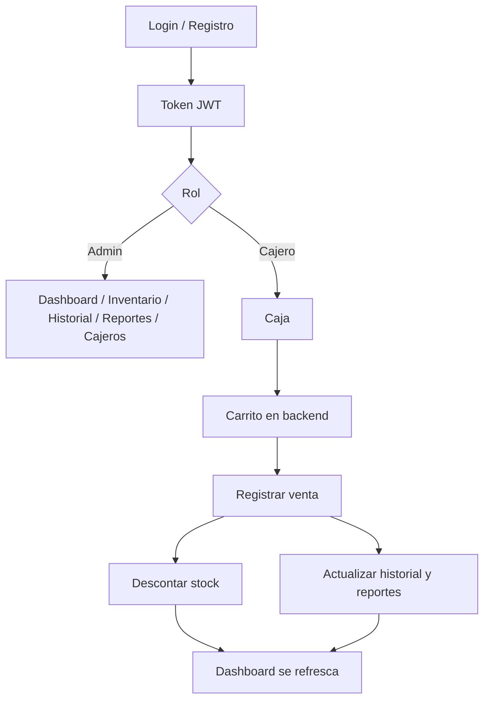

# Gestor Inventario

Sistema POS y de inventario para tiendas pequeñas, medianas y grandes.

## Propósito

Resolver el control operativo de una tienda en un solo sistema:

- inventario con stock mínimo por producto
- caja con flujo de venta para cajeros
- historial y reportes para administración
- categorías CRUD
- control de cajeros por tienda
- analítica en tiempo real

Está pensado para tiendas que necesitan vender, registrar stock, ver alertas y tomar decisiones sin depender de hojas de cálculo o procesos manuales.

## Stack Tecnológico

### Frontend

- `React 18.3.1`: interfaz de usuario
- `TypeScript 5.7.3`: tipado estricto
- `Vite 5.4.12`: desarrollo y build
- `React Router DOM 6.30.1`: rutas y navegación
- `Axios 1.8.0`: consumo de API
- `Recharts 2.15.3`: gráficas y analítica
- `Tailwind CSS 3.4.17`: estilos

### Backend

- `Node.js` + `Express 5.2.1`: API HTTP
- `TypeScript 5.7.3`: tipado estricto
- `MongoDB Atlas` + `Mongoose 8.9.5`: persistencia
- `bcryptjs 3.0.3`: hashes de contraseñas
- `jsonwebtoken 9.0.3`: autenticación por token
- `cors 2.8.5`: acceso del frontend
- `dotenv 16.4.7`: variables de entorno
- `morgan 1.10.0`: logs de peticiones

### Herramientas de desarrollo

- `ts-node-dev 2.0.0`: backend en modo desarrollo
- `npm`: instalación y ejecución

## Qué se hizo

### Evolución por fases

#### Fase 1

- estructura base del proyecto
- frontend y backend separados
- modelos y vistas iniciales
- CRUD base
- primer flujo POS

#### Fase 2

- conexión real con MongoDB Atlas
- migración desde persistencia temporal a API real
- servicios HTTP centralizados con Axios
- analítica básica en dashboard
- ventas con validación real de stock

#### Fase 3

- login y registro mejorados
- separación de roles admin/cajero
- caja persistente en backend
- historial de ventas
- reportes avanzados
- categorías dedicadas
- cajeros con gestión administrativa

#### Fase actual, MVP consolidado

- inventario con `stockMinimo` por producto
- categorías CRUD
- caja exclusiva para cajeros
- historial filtrable por cajero
- reportes con filtros por período y cajero
- ventas y stock actualizados en tiempo real
- modal profesional de cierre de venta
- impresión de factura con cambio
- mejor UX general

## Arquitectura

### Frontend

El frontend consume la API real y mantiene la lógica de negocio separada por servicios.

- `componentes/`: piezas reutilizables de UI
- `paginas/`: pantallas principales
- `servicios/`: llamadas HTTP y utilidades
- `contexto/`: sesión y autenticación
- `tipos/`: modelos TypeScript compartidos

### Backend

El backend está organizado por dominio.

- `modelos/`: esquemas de MongoDB y tipos
- `controladores/`: lógica de negocio
- `rutas/`: endpoints HTTP
- `middleware/`: autenticación y roles
- `utilidades/`: helpers de respuestas

## Cómo funciona la API

La API sigue el formato:

```json
{ "mensaje": "...", "datos": ... }
```

### Flujo general

1. La ruta recibe la petición.
2. El middleware valida token y rol.
3. El controlador ejecuta la lógica.
4. El modelo accede a MongoDB.
5. Se responde con `{ mensaje, datos }`.

### Ejemplo

- `GET /api/productos`
- `POST /api/ventas`
- `GET /api/ventas/historial`
- `GET /api/analitica/reporte`

## Cómo se conectan controladores, modelos y rutas

- `rutas`: exponen los endpoints.
- `controladores`: reciben `req`, validan, consultan y responden.
- `modelos`: definen cómo se guardan los datos en MongoDB.

Ejemplo:

- `rutas/productos.rutas.ts` llama a `controladores/productos.controlador.ts`
- el controlador usa `modelos/producto.modelo.ts`
- la respuesta vuelve al frontend con Axios

## Conexión con la base de datos

El backend usa MongoDB Atlas.

### Archivo

- `backend/.env`

### Variables principales

```env
MONGO_URI=mongodb+srv://<usuario>:<contraseña>@<cluster>.mongodb.net/?appName=Cluster0
JWT_SECRETO=tu_secreto
JWT_EXPIRA=7d
PUERTO=3001
```

### Arranque

1. `src/servidor.ts` carga variables con `dotenv`.
2. `mongoose.connect(MONGO_URI)` abre conexión.
3. Se registran las rutas en `/api`.
4. El servidor escucha en el puerto configurado.

## Estructura de carpetas

```text
Gestor_Inventario/
├─ frontend/
│  └─ src/
│     ├─ componentes/     UI reutilizable
│     ├─ contexto/        sesión y auth
│     ├─ datos/           datos de ejemplo
│     ├─ paginas/         pantallas
│     ├─ servicios/       llamadas a API
│     └─ tipos/           tipos TS compartidos
├─ backend/
│  └─ src/
│     ├─ controladores/   lógica de negocio
│     ├─ middleware/      auth y permisos
│     ├─ modelos/         esquemas MongoDB
│     ├─ rutas/           endpoints REST
│     ├─ scripts/         semillas y utilidades
│     └─ utilidades/      helpers de respuesta
└─ README.md
```

## Instalación

### 1. Clonar o abrir el proyecto

```bash
git clone <url-del-repositorio>
cd Gestor_Inventario
```

### 2. Instalar dependencias

```bash
cd frontend
npm install
```

```bash
cd ../backend
npm install
```

### 3. Configurar variables de entorno

Crear `backend/.env` con:

```env
MONGO_URI=...
JWT_SECRETO=...
JWT_EXPIRA=7d
PUERTO=3001
```

### 4. Ejecutar en desarrollo

Backend:

```bash
cd backend
npm run dev
```

Frontend:

```bash
cd frontend
npm run dev
```

## Comandos útiles

### Frontend

```bash
npm run dev
npm run build
npm run preview
npm run typecheck
```

### Backend

```bash
npm run dev
npm run build
npm run start
npm run typecheck
npm run poblar
```

## Funcionalidades principales

- login y registro por tienda
- roles `admin` y `cajero`
- caja exclusiva para cajero
- inventario con stock mínimo por producto
- categorías CRUD
- ventas con descuento automático de stock
- historial de ventas por fecha y cajero
- reportes con filtros y analítica
- gestión de cajeros
- persistencia real del carrito de caja

## Roles

### Admin

- ve dashboard, inventario, historial, reportes y cajeros
- gestiona productos, categorías y cajeros
- consulta ventas y analítica global de la tienda

### Cajero

- solo accede a Caja
- registra ventas con stock real
- ve cambio, factura e impresión
- su actividad queda asociada a su usuario y tienda

## Endpoints principales

| Método | Ruta | Uso |
| --- | --- | --- |
| `POST` | `/api/auth/registro` | Registrar tienda y admin |
| `POST` | `/api/auth/login` | Iniciar sesión |
| `GET` | `/api/productos` | Listar productos |
| `POST` | `/api/productos` | Crear producto |
| `PUT` | `/api/productos/:id` | Editar producto |
| `DELETE` | `/api/productos/:id` | Eliminar producto |
| `GET` | `/api/categorias` | Listar categorías |
| `POST` | `/api/categorias` | Crear categoría |
| `PUT` | `/api/categorias/:id` | Editar categoría |
| `DELETE` | `/api/categorias/:id` | Eliminar categoría |
| `GET` | `/api/carrito` | Obtener carrito del cajero |
| `POST` | `/api/carrito` | Guardar carrito del cajero |
| `DELETE` | `/api/carrito` | Limpiar carrito del cajero |
| `GET` | `/api/ventas` | Listar ventas |
| `POST` | `/api/ventas` | Registrar venta |
| `GET` | `/api/ventas/historial` | Historial con filtros |
| `GET` | `/api/analitica/resumen` | Resumen del día |
| `GET` | `/api/analitica/semanal` | Ventas semanales |
| `GET` | `/api/analitica/reporte` | Reporte general |
| `GET` | `/api/analitica/productos-mas-vendidos` | Ranking de productos |
| `GET` | `/api/usuarios` | Listar cajeros |
| `POST` | `/api/usuarios` | Crear cajero |
| `PATCH` | `/api/usuarios/:id/estado` | Activar o desactivar cajero |
| `DELETE` | `/api/usuarios/:id` | Eliminar cajero |

## Guía para Postman

Base URL:

```text
http://localhost:3001/api
```

### 1. Registrar tienda

`POST /auth/registro`

Body JSON:

```json
{
  "nombreTienda": "Tienda D1",
  "nombrePropietario": "Martha",
  "correo": "martha@tienda.com",
  "contrasena": "12345678",
  "confirmarContrasena": "12345678"
}
```

### 2. Iniciar sesión

`POST /auth/login`

Body JSON:

```json
{
  "correo": "martha@tienda.com",
  "contrasena": "12345678"
}
```

Respuesta esperada:

- `token`
- `usuario`

Usa el token en Postman como `Bearer Token` o en header:

```text
Authorization: Bearer TU_TOKEN
```

### 3. Ver perfil de sesión

`GET /auth/perfil`

Headers:

```text
Authorization: Bearer TU_TOKEN
```

### 4. Crear producto

`POST /productos`

Headers:

```text
Authorization: Bearer TU_TOKEN
Content-Type: application/json
```

Body JSON:

```json
{
  "nombre": "Arroz Diana 1 kg",
  "codigoProducto": "ARZ-001",
  "precio": 5200,
  "stock": 40,
  "stockMinimo": 10,
  "categoria": "GRANOS",
  "imagenUrl": "https://placehold.co/600x600"
}
```

### 5. Editar producto
.0
`PUT /productos/:id`

Body JSON:

```json
{
  "nombre": "Arroz Diana 1 kg",
  "codigoProducto": "ARZ-001",
  "precio": 5300,
  "stock": 38,
  "stockMinimo": 10,
  "categoria": "GRANOS",
  "imagenUrl": "https://placehold.co/600x600"
}
```

### 6. Crear categoría

`POST /categorias`

Body JSON:

```json
{
  "nombre": "Granos"
}
```

### 7. Editar categoría

`PUT /categorias/:id`

Body JSON:

```json
{
  "nombre": "Cereales"
}
```

### 8. Crear cajero

`POST /usuarios`

Body JSON:

```json
{
  "nombre": "Cajero 1",
  "correo": "cajero1@tienda.com",
  "contrasena": "12345678"
}
```

### 9. Listar cajeros

`GET /usuarios`

### 10. Registrar venta

`POST /ventas`

Body JSON:

```json
{
  "productos": [
    {
      "productoId": "prod-001",
      "cantidad": 2
    }
  ],
  "total": 10400,
  "ganancia": 10400,
  "metodoPago": "Efectivo",
  "fecha": "2026-04-13T12:00:00.000Z",
  "cajero": "Cajero 1"
}
```

### 11. Ver historial

`GET /ventas/historial?desde=2026-04-13&hasta=2026-04-13&metodoPago=Efectivo`

### 12. Ver analítica

`GET /analitica/resumen`

`GET /analitica/semanal`

`GET /analitica/reporte?desde=2026-04-13&hasta=2026-04-13`

### 13. Carrito del cajero

`GET /carrito`

`PUT /carrito`

Body JSON:

```json
{
  "productos": [
    {
      "productoId": "prod-001",
      "nombre": "Arroz Diana 1 kg",
      "cantidad": 1,
      "precioUnitario": 5200,
      "subtotal": 5200
    }
  ]
}
```

`DELETE /carrito`

### 14. Eliminar o activar cajero

`PATCH /usuarios/:id/estado`

`DELETE /usuarios/:id`

## Recomendaciones para probar en Postman

1. Primero registra la tienda.
2. Luego inicia sesión y copia el token.
3. Agrega el token en Authorization para todas las rutas protegidas.
4. Crea categorías antes de crear productos.
5. Crea productos con códigos únicos por tienda.
6. Registra una venta para comprobar stock, historial y reportes.


## Flujo general



## Flujo de venta

1. El cajero agrega productos al carrito.
2. El carrito se guarda en backend por usuario y tienda.
3. Al finalizar, el sistema valida stock y forma de pago.
4. Se registra la venta en MongoDB.
5. El stock se descuenta en la misma transacción.
6. El dashboard, historial y reportes se actualizan.
7. La factura muestra total, efectivo recibido y cambio.

## Flujo de categorías

1. El admin crea una categoría desde Inventario.
2. Puede editarla o eliminarla desde la lista.
3. Las categorías se guardan por tienda.
4. Los productos usan categorías normalizadas en mayúscula.

## Notas del MVP

Este proyecto llegó a un MVP funcional para operación real en tienda pequeña o mediana, con capacidad de escalar a tiendas más grandes por separación de dominios, multiusuario por tienda e integración con MongoDB Atlas.

El foco principal fue evitar procesos manuales, mejorar control de ventas, disminuir errores de caja y dar visibilidad al stock y al movimiento de dinero en tiempo real.

## Verificación rápida

1. Inicia backend y frontend.
2. Abre sesión como admin o cajero.
3. Registra una venta desde Caja.
4. Verifica que el stock baje.
5. Revisa `Inicio`, `Historial` y `Reportes` para ver la actualización.


## Pruebas automatizadas con Cypress

Suite E2E (interfaz y API) del Gestor Inventario Web. Cada spec lleva en el nombre el ID del caso de prueba del documento de casos (por ejemplo `cp-caj-001-...`).

### Requisitos

- Node.js 22 o superior
- Frontend en `http://localhost:5173` y backend en `http://localhost:3001` en ejecución
- Una tienda de prueba con: un administrador, un cajero y el producto «Arroz 500 g» (código `ARR-500`, con stock)
- No ejecutar `npm run poblar` (borra productos y ventas de toda la base de datos)

### Instalación

```bash
cd frontend
npm install
```

### Credenciales (no se suben a Git)

Copie la plantilla y complete con los datos de la tienda de prueba:

```bash
cp cypress.env.example.json cypress.env.json
```

`cypress.env.json` está en `.gitignore`. También pueden usarse variables de entorno `CYPRESS_adminCorreo`, `CYPRESS_adminContrasena`, `CYPRESS_cajeroCorreo` y `CYPRESS_cajeroContrasena`.

### Ejecución

```bash
npx cypress run                                  # toda la suite
npx cypress run --spec "cypress/e2e/cp-seg-*"    # solo los casos de seguridad
npx cypress open                                 # modo interactivo
```

La URL de la aplicación (`baseUrl`) y de la API (`env.apiUrl`) se definen en `cypress.config.js`.

### Estructura

```
frontend/
├── cypress.config.js          # baseUrl, API y opciones
├── cypress.env.example.json   # plantilla de credenciales (sin datos reales)
└── cypress/
    ├── e2e/                   # specs *.cy.js, uno por caso de prueba
    ├── fixtures/              # datos de prueba
    └── support/               # comandos: loginAdmin, loginCajero, apiLogin
```

### Resultados esperados

Algunos specs **fallan a propósito**: verifican el resultado esperado del caso y el fallo evidencia un defecto real de la aplicación (ver reporte de defectos del informe).


